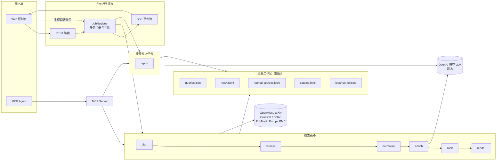

# Sextant · 六分仪

> **赛道 B（AI Application）参赛作品**：输入一个研究主题，自动完成「查询规划 → 多源检索 → 去重归一 → 相关性排序 → 证据目录」，并按需生成中英双语调研报告。全过程可观察、可追溯、可重跑。

代码仓库：<https://github.com/njuptemmm/Sextant> · 版本 `0.1.0` · Python 3.11+ · 无需数据库、消息队列或 GPU

Sextant 面向需要**持续跟踪某个研究方向**的人：研究生、研发工程师、技术选型负责人。它的产物不是一段聊天回复，而是一份能直接用于组会、立项或选型讨论的**证据目录**——每条记录都带来源、发表日期、引用数、摘要和排序理由；报告是按需启动的独立任务，不影响目录使用。

---

## 评委快速阅读

| 评分项 | 先看 | 关键证据 |
|---|---|---|
| 场景价值与痛点（20） | [§1](#1-场景与价值) + [docs/scenario-and-value.md](docs/scenario-and-value.md) | 用户画像、现有方案对比、真实运行数据、成功标准 |
| 系统架构与技术选型（15） | [§4](#4-系统架构) + [docs/architecture.md](docs/architecture.md) | 架构图、组件职责、状态与恢复设计 |
| Agent 能力与链路（20） | [§5](#5-agent-执行链路) + [docs/agent-flow.md](docs/agent-flow.md) | 六段契约、MCP 工具、状态管理、失败恢复 |
| 工程完成度与 Demo（20） | [§2](#2-三分钟现场演示) / [§3](#3-五分钟复现) + [docs/error-handling.md](docs/error-handling.md) / [docs/observability.md](docs/observability.md) / [docs/evidence.md](docs/evidence.md) | 可运行路径、异常处理、SSE/JSONL 原始证据 |
| 成本、性能与工程化（10） | [§8](#8-成本与性能) + [docs/cost-and-performance.md](docs/cost-and-performance.md) | 实测延迟、token/成本、瓶颈与优化方向 |
| 答辩与边界 | [§12](#12-已知限制与下一步) | 已完成目标、未解决问题、下一步计划 |

---

## 1. 场景与价值

**主用户**：需要每周/每两周向组会、开题或项目立项汇报「这个方向最近有什么新工作」的研究生和初级研究者。他们没有专职情报人员，也没有商业数据库预算，但需要把「为什么选这几篇」讲清楚。

**真实痛点**：不是搜不到，而是从搜到到可用之间有一段重复劳动——在 4–6 个入口之间切换、逐条比对重复论文、读 100 条摘要、再把链接和年份搬进汇报材料；下周想复现同一批结果时，搜索词和筛选理由已经丢了。

**Sextant 的增量**：把「发现 → 去重 → 排序 → 交付」做成一条有状态、可审计的链路：

- **多源并行**：OpenAlex、arXiv、Crossref、DOAJ；生物医学主题自动追加 PubMed / Europe PMC；配置 Key 后启用 Semantic Scholar。同一 DOI 只保留一条，并标注被几个来源同时命中。
- **排序可解释**：关键词覆盖 40 + 标题命中 10 + 引用量 20 + 时效性 20 + 跨源印证 5 + 质量 5，每一项都写进记录，不是黑箱。
- **证据可追溯**：每条记录带来源、日期、引用数、摘要和分数构成；目录是自包含 HTML，可离线打开。
- **有状态、可重跑**：每个阶段把结果写回工作区，失败不会留下半截状态；每次运行有独立日志和 `run_id`，控制台「重跑」重新执行整条链路，历史运行记录保留在 `runs.json`，旧报告会被作废。
- **不是聊天套壳**：证据由确定性的检索/去重/排序产生，不配置模型时整条链路照常可用；模型只做查询扩展、中文增强和报告写作，失败时降级。

一次真实运行（主题 `Agent Memory Systems Acceptance`，4 个来源，`deepseek-flash`）：120 条原始记录 → 去重后 102 条 → Top 20 进入报告；检索 + 中文增强约 128 秒，报告约 1–2 分钟。人工按每条摘要粗读 40–60 秒估算，仅初筛 100 条就需要 70–100 分钟。

完整分析见 [docs/scenario-and-value.md](docs/scenario-and-value.md)。

---

## 2. 三分钟现场演示

1. 打开控制台，输入主题 `LLM agent evaluation`，关键词 `LLM agent, evaluation, benchmark`，点击「开始检索」。
2. 观察六段式时间线实时推进：查询规划 → 多源检索 → 去重归一 → 中文增强 → 相关性排序 → 目录生成。每一步显示耗时与条数；目录生成后本次检索立即结束。
3. 点击「打开目录」：按研究方向分组，支持来源 / 年份 / 类型筛选与中英摘要切换。
4. 点击「生成调研报告」：报告是独立任务，有自己的 `run_id`、日志和 SSE 进度，基于 Top 20 证据生成中英双语报告（执行摘要、六个分析小节、按方法家族聚合的论文卡片）。生成期间目录始终可用。
5. 回到控制台点「重跑」：展示同一主题的第二次运行、日志按 `run_id` 隔离、旧报告被作废。
6. （可选）用 MCP 客户端调用 `run_topic` 生成目录，再调用 `generate_report` 启动报告任务，展示同一能力脱离 Web 界面也能被 Agent 使用。

> 现场以真实运行为主；录屏只作为网络或外部接口故障时的备用材料。外部学术源不可用时，可切换到已缓存的主题工作区继续演示目录、筛选、报告和日志。

---

## 3. 五分钟复现

### 本地 Python（推荐现场演示）

```bash
git clone https://github.com/njuptemmm/Sextant.git
cd Sextant

python -m venv .venv
source .venv/bin/activate        # Windows: .venv\Scripts\activate
pip install -e .                 # 安装依赖，并注册 sextant / sextant-mcp 命令
cp .env.example .env             # 可留空，不配模型也能跑

sextant                          # 或：python -m sextant
```

打开 <http://localhost:8000>。MCP 服务另开一个终端：`sextant-mcp`（<http://localhost:8001/mcp>）。

要求 Python 3.11+，无需数据库、无需消息队列、无需 GPU。

### Docker

```bash
cp .env.example .env      # 可留空，不配模型也能跑
docker compose up --build
```

打开 <http://localhost:8000>，MCP 服务在 <http://localhost:8001/mcp>。

> Docker Desktop 依赖 WSL2，需要在 Windows 中启用「虚拟机平台」可选组件并在 BIOS 开启虚拟化
> （管理员 PowerShell：`wsl --install --no-distribution`，重启后生效）。如果本机只能用 Python 运行，
> 忽略本节即可——本地 Python 路径与容器路径的行为完全一致。

### 验证安装

```bash
pytest -q          # 74 passed
ruff check .       # All checks passed
```

### 可选：接入大模型

在 `.env` 中填入任意 **OpenAI 兼容**接口即可获得中文标题、中文摘要、语义化研究方向归类和调研报告：

```dotenv
SEXTANT_LLM_BASE_URL=https://api.deepseek.com/v1
SEXTANT_LLM_API_KEY=sk-...
SEXTANT_LLM_MODEL=deepseek-chat
```

不配置时整条检索链路照常运行，目录退回英文原文摘要 + 规则驱动的方向归类；报告入口会明确拒绝启动，而不是静默失败。

---

## 4. 系统架构

### 4.1 组件与数据流



**分层与依赖方向**：`web → api → pipeline → engine`。

- `engine`：可移植的检索、解析、质量门控与渲染内核，纯函数为主，可单独测试。
- `pipeline`：只做编排，每个阶段从工作区读、往工作区写，保证可重入。
- `api`：只做协议、校验、任务注册和 SSE，不解析外部响应体。
- `mcp`：把同一套 `pipeline` 暴露为 MCP 工具，不复制业务逻辑。

### 4.2 关键设计决策

| 决策 | 选择 | 理由 | 代价 |
|---|---|---|---|
| 部署形态 | 分层单体 | 边界清晰、部署简单，一条 `docker compose up` 即可复现 | 模块边界靠约定维持 |
| 状态 | 磁盘工作区 | 进程崩溃不丢已完成结果；评委可 `cat` 日志和 JSONL 直接核验 | 工作区需持久化卷 |
| 异步任务 | 进程内线程池，而非 Celery | 零外部依赖，`docker compose up` 即可复现 | 任务状态在进程内，重启后运行中的任务需重跑 |
| 进度推送 | SSE，而非 WebSocket | 单向事件流足够；浏览器自动重连；实现和排障都更简单 | 不支持双向交互 |
| 报告 | 独立任务，而非第 7 段 | 报告昂贵、可选；目录不应等报告 | 多一个任务类型和互斥关系 |
| 排序 | 可解释加权，而非黑箱模型 | 评委和用户都能看到每一项分数；无模型也能用 | 对同义表达不敏感 |

### 4.3 负载、状态与故障恢复

| 维度 | 当前设计 | 依据 |
|---|---|---|
| 负载 | 按需运行，峰值 1–3 个并发主题 | 目标用户是个人研究者/小团队 |
| 状态 | 全部在磁盘；内存只有运行注册表与事件订阅者 | 进程崩溃不丢已完成结果 |
| 故障恢复 | 单源失败隔离；阶段失败写日志并保留中间产物；重跑复用主题目录 | 见 [docs/error-handling.md](docs/error-handling.md) |
| 超时 | 外部请求 30 秒、重试 2 次；模型 45 秒；报告单次 180 秒 | 学术接口典型 P99 在 5 秒内 |

---

## 5. Agent 执行链路

### 5.1 六段检索 + 独立报告任务

| 阶段 | 输入 | 动作 | 输出 | 失败处理 |
|---|---|---|---|---|
| plan | 主题、关键词 | 选择来源；生成每源检索式；可选让模型扩充同义词 | `01_queries/queries.json` | 模型失败自动退回规则检索式 |
| retrieve | 检索式 | 每个来源一个线程，串行执行该源的查询以尊重限流 | `02_raw/search/<source>.jsonl` | 单源失败记录后继续；全部失败才终止 |
| normalize | 原始记录 | DOI / 标题指纹去重，合并多源命中与摘要 | 内存记录 + `pending_verification_articles.jsonl` | 摘要不合格的记录进入待核实区，不参与排序 |
| enrich | 可用记录 | 可选：中文标题、中文摘要、一句话结论、研究方向 | 记录字段 | 单批失败只丢弃该批，其余批次照常写回；全部失败时退回规则模式 |
| rank | 记录 + 主题 | 关键词 40 + 标题 10 + 引用 20 + 时效 20 + 跨源 5 + 质量 5 | `03_processed/ranked_articles.jsonl` | 纯函数，无外部依赖 |
| render | 排序结果 | 分组、筛选、中英对照，写入自包含 HTML | `output/catalog.html` | 中文质量门控失败时降级渲染并告警 |
| report（独立） | 排序结果 + 查询计划 | 用户点击后启动：批量提炼研究影响 + 综合写作 + 渲染 | `04_summary/*.json`、`output/综合调研报告：*.html` | 未配置模型、文献不足或校验失败时返回失败事件并保留旧报告 |

前六段串行构成一次检索，每一段都会向 `logs/<run_id>.jsonl` 追加结构化事件并推送到 SSE。**报告不是第 7 段**：它有自己的任务、日志和 SSE 流，目录生成后立即可用。

### 5.2 MCP 与 Web 的关系

MCP 不是第二套系统。`sextant/mcp/server.py` 调用同一套 `pipeline`，只是把入口从 HTTP 换成了 MCP 工具。MCP 是独立进程，通过工作区与 API 共享产物和日志。

| 工具 | 作用 |
|---|---|
| `list_sources` | 列出可用来源、学科与权威等级 |
| `search_papers` | 单源快速检索，不写工作区 |
| `create_topic` | 创建主题并异步启动运行，立即返回 `run_id` |
| `run_topic` | 阻塞式跑检索链路，返回目录路径与统计 |
| `generate_report` | 为已有目录的主题启动报告任务，立即返回 `run_id` |
| `get_topic` | 读取主题信息与排名靠前的记录 |
| `get_run_status` | 查询异步运行状态 |
| `score_records` | 对已有记录按主题打分，不落盘 |

答辩口径：**一套内核，两种交付形态**——人用 Web 控制台，Agent 用 MCP 工具。两者的阶段契约、日志格式和产物结构完全一致；任务互斥只在各自进程内生效。

接入配置：

```json
{
  "mcpServers": {
    "sextant": {
      "type": "http",
      "url": "http://localhost:8001/mcp"
    }
  }
}
```

> 公网部署时把 `localhost` 换成实际域名，并加反向代理与鉴权。

---

## 6. 异常处理

设计原则：**失败要局部化、可解释、可恢复**。

| 失败域 | 典型场景 | 系统行为 |
|---|---|---|
| 请求级 | 参数非法、主题重复、路径越界 | 立即返回 4xx，不启动任务 |
| 运行级 | 检索全部失败、无可用记录 | 终止运行，保留中间产物并写日志 |
| 来源级 | 单个学术源超时/限流/解析失败 | 该来源记 `warning`，其余来源继续 |
| 查询级 | 同源内某条检索式失败 | 记录后继续下一条 |
| 模型级 | 超时、非法 JSON、字段缺失 | 丢弃增强，退回规则模式；单批失败只损失该批 10 条 |
| 报告级 | 未配置模型、文献不足、综合截断 | 返回失败或 `warning` 事件；保留旧报告；按方法家族确定性归组兜底 |
| 渲染级 | 中文质量门控不通过 | 降级渲染并告警 |

**状态恢复**：每个阶段只依赖工作区文件，可独立重入，失败不会留下半截状态被下一阶段误用；控制台「重跑」从 plan 重新执行整条链路，上一轮日志和 `runs.json` 记录保留，`catalog.html` 会被本轮覆盖。进程重启后已完成产物和 `runs.json` 仍在，运行中的任务需要重跑。

**人工介入点**：失败后用户可以重跑、修改关键词新建主题、直接查看 `logs/<run_id>.jsonl` 定位阶段；报告失败不会删除目录或旧报告。

细节见 [docs/error-handling.md](docs/error-handling.md)。

---

## 7. 可观测性

| 证据 | 位置 | 内容 |
|---|---|---|
| 结构化运行日志 | `workspace/<topic>/logs/<run_id>.jsonl` | 每条事件含 `seq / ts / stage / status / duration_ms / data` |
| 运行汇总 | `workspace/<topic>/output/run_summary.json` | 原始条数、去重后条数、待核实条数、各阶段耗时、模型名 |
| 实时进度 | `GET /api/topics/{id}/events?run_id=` | SSE 推送阶段状态；断线重连按 `seq` 去重 |
| 运行历史 | `workspace/<topic>/runs.json` | 检索运行的状态、耗时、产物路径（报告任务不写入，避免污染） |
| 健康检查 | `GET /api/health` | 版本、模型状态、工作区可写性 |
| 失败诊断 | 日志事件 | `error_type` + `hint`，例如超时提示检查网络或降低并发 |

常用排查命令：

```bash
# 每个阶段的耗时
jq -r 'select(.status=="completed") | [.stage, .duration_ms] | @tsv' logs/<run_id>.jsonl

# 哪些来源失败了
jq -r 'select(.status=="warning") | [.stage, .message] | @tsv' logs/<run_id>.jsonl
```

一次真实运行的阶段耗时、报告任务事件序列和降级日志摘录见 [docs/evidence.md](docs/evidence.md)；机制说明见 [docs/observability.md](docs/observability.md)。

---

## 8. 成本与性能

### 8.1 实测延迟

| 场景 | 配置 | 原始记录 | 去重后 | 总耗时 |
|---|---|---:|---:|---:|
| 每源 5 条 | 无模型 | 20 | 17 | **1.2 s** |
| 每源 20 条 | 无模型 | 80 | 59 | **1.8 s** |
| 检索 + 中文增强 | `deepseek-flash`，40 条增强上限 | 120 | 102 | **约 128 s** |
| 调研报告（独立的 20 篇） | `deepseek-flash` | 20 篇证据 | — | **80–135 s**（随模型输出长度浮动） |

- 无模型时 93%–99% 的延迟花在等外部 API；纯本地阶段合计 < 120 ms。
- 有模型时 `enrich` 是主要耗时（约 110 秒，4 批串行），但目录与报告互不阻塞。
- 报告是可选独立任务，生成期间目录始终可访问。

### 8.2 成本

| 项目 | 成本 |
|---|---|
| 外部学术 API | **¥0**（全部免费；Semantic Scholar 的 Key 也是免费额度） |
| 检索 + 中文增强（40 条上限） | 约 **¥0.04/次**（按输入 1 元/百万 token、输出 2 元/百万 token 估算） |
| 调研报告（20 篇） | 约 5 次模型调用，按同一价位约 **¥0.05–0.1/份**（估算） |
| 一次比赛演示（3–5 次运行） | 不到 **¥0.5** |

### 8.3 资源消耗

| 指标 | 实测值 |
|---|---|
| API 进程常驻内存（空闲 / 跑完一次） | ≈ 54 MB / ≈ 61 MB |
| `/api/health` 延迟（热） | 2–4 ms |
| 单个主题工作区（59 条记录） | 855 KB |
| `catalog.html`（59 条记录） | 303 KB，自包含、无外部 CDN |

### 8.4 瓶颈与优化方向

1. **检索等待（占比 > 90%）**：按 `(来源, 查询, 时间范围)` 缓存并设置 TTL；同一来源的多条查询在限速允许时合并。
2. **arXiv 3 秒/请求限速**：上游规则，不绕过；当前每源最多 2 条查询，把最坏情况控制在约 6 秒。
3. **LLM 增强串行**：4 批依次调用；可并行到 2 路，但更容易触碰供应商并发限制，当前选择「稳」。
4. **单主题单活跃任务**：防止两路写入同一目录，保证产物一致。

细节见 [docs/cost-and-performance.md](docs/cost-and-performance.md)。

---

## 9. 工程质量

- **测试**：`pytest -q` → 74 passed，覆盖路径校验、跨源去重、摘要质量门控、排序单调性、查询计划合并、API 错误码、无模型降级、LLM 分批与单批失败隔离、报告独立事件流与任务互斥。
- **静态检查**：`ruff check .` → All checks passed（line-length 120）。
- **可复现**：固定依赖区间，`pip install -e .` 或 `docker compose up --build` 两条路径行为一致。
- **密钥**：只从环境变量读取；`.env` 在 `.gitignore` 中；仓库不含真实密钥。

---

## 10. 接口与配置

<details>
<summary>HTTP API</summary>

| 方法 | 路径 | 说明 |
|---|---|---|
| GET | `/` | 控制台 |
| GET | `/api/health` | 版本、模型状态、工作区可写性 |
| POST | `/api/topics` | 创建主题并启动运行（202） |
| GET | `/api/topics` | 主题列表 |
| GET | `/api/topics/{id}` | 主题详情、最近运行、`active_report` |
| POST | `/api/topics/{id}/rerun` | 重跑 |
| GET | `/api/topics/{id}/records` | 分页读取排序结果 |
| GET | `/api/topics/{id}/catalog` | 目录 HTML |
| POST | `/api/topics/{id}/report` | 启动独立报告任务（202） |
| GET | `/api/topics/{id}/report` | 报告 HTML |
| GET | `/api/topics/{id}/events?run_id=` | SSE 事件流（检索与报告各自独立） |
| GET | `/api/topics/{id}/logs/{run_id}` | 原始 JSONL 日志 |
| GET | `/api/runs/{run_id}` | 运行状态 |

交互式文档：<http://localhost:8000/api/docs>

</details>

<details>
<summary>环境变量</summary>

| 环境变量 | 默认值 | 说明 |
|---|---|---|
| `SEXTANT_WORKSPACE_ROOT` | `./workspace` | 主题工作区根目录 |
| `SEXTANT_HOST` / `SEXTANT_PORT` | `127.0.0.1` / `8000` | API 监听地址 |
| `SEXTANT_MCP_PORT` | `8001` | MCP 监听端口 |
| `SEXTANT_MAX_RESULTS_PER_SOURCE` | `20` | 每源每查询返回上限（1–50） |
| `SEXTANT_SOURCE_CONCURRENCY` | `4` | 来源并发数 |
| `SEXTANT_LLM_BASE_URL` | 空 | OpenAI 兼容接口根地址 |
| `SEXTANT_LLM_API_KEY` | 空 | 模型密钥，**只从环境变量读取** |
| `SEXTANT_LLM_MODEL` | 空 | 模型名 |
| `SEXTANT_REPORT_ENABLED` | `1` | 是否允许按需生成调研报告（`0` 关闭入口） |
| `SEXTANT_REPORT_MAX_PAPERS` | `20` | 进入报告的 Top-N 文献数 |
| `SEXTANT_LLM_REPORT_BATCH_SIZE` | `5` | 报告分析每批文献数 |
| `SEXTANT_LLM_REPORT_TIMEOUT` | `180` | 单次报告调用超时（秒） |
| `SEMANTIC_SCHOLAR_API_KEY` | 空 | 配置后自动启用 Semantic Scholar |

</details>

---

## 11. 目录结构

```
sextant/
├── sextant/
│   ├── config.py            环境变量集中读取
│   ├── workspace.py         主题工作区与运行历史
│   ├── runlog.py            JSONL 日志 + SSE 事件总线
│   ├── llm.py               OpenAI 兼容封装（可降级）
│   ├── sources_registry.py  来源选择与检索式生成
│   ├── engine/              检索适配器、质量门控、HTML 渲染内核
│   ├── pipeline/            plan / retrieve / normalize / rank / report
│   ├── api/                 FastAPI 应用、任务注册表、路由
│   ├── mcp/server.py        MCP 工具集
│   └── web/index.html       单文件控制台
├── tests/                   单元 + API 冒烟测试
├── docs/                    架构、Agent 流程、异常、可观测性、成本性能、场景价值、运行证据
├── Dockerfile
├── docker-compose.yml
└── README.md
```

---

## 12. 已知限制与下一步

| 限制 | 影响 | 下一步 |
|---|---|---|
| 只做摘要级证据 | 不能替代全文精读 | 接入开放获取全文解析与引用上下文 |
| 排序未做向量召回 | 对同义表达不敏感 | 增加 embedding 召回，保留可解释打分 |
| 任务调度在进程内 | 进程重启后运行中的任务需要重跑 | 已完成产物保留，重跑成本可控 |
| 无鉴权 | 默认只监听本机 | 对外部署加反向代理与访问控制 |
| 报告质量依赖模型 | 综合调用截断时可能降级分组 | 预算翻倍策略 + 方法家族确定性归组兜底 |
| 未覆盖中文文献/专利 | 部分场景覆盖不足 | 增加中文来源适配器 |

**已经完成**：六段检索链路、多源去重、可解释排序、自包含目录、按需中英双语报告、MCP 工具、独立任务与 SSE、结构化日志、Docker 交付、74 项测试。

**下一步优先级**：先补用户研究/排序质量标注，再做全文精读与向量召回；可观测性证据已整理在 [docs/evidence.md](docs/evidence.md)，后续接入指标后端即可。

---

## License

MIT
