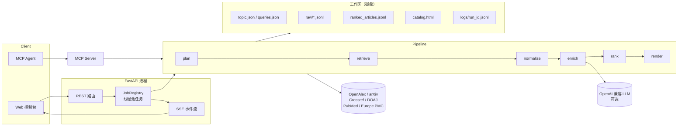

# Sextant · 六分仪

> 输入一个研究主题，自动完成「查询规划 → 多源检索 → 去重归一 → 相关性排序 → 生成可筛选证据目录」，全过程可观察、可追溯、可重跑。

Sextant 面向需要**持续跟踪某个研究方向**的人：研究生、研发工程师、技术选型负责人。它的产物不是一段聊天回复，而是一份能直接用于组会、立项或选型讨论的**证据目录**——每条记录都带来源、发表日期、引用数、摘要和排序理由。

---

## 1. 解决什么问题

| | 现在怎么做 | 问题 |
|---|---|---|
| 手动检索 | 在 Google Scholar / arXiv / 数据库之间来回切换 | 重复劳动；同一个工作在不同库里出现多次；容易漏掉预印本 |
| 通用聊天助手 | 让模型「总结一下某领域进展」 | 无法给出可核验的来源；不能限定时间窗；每次结果不一致 |
| 文献管理工具 | Zotero / EndNote | 只管理已收集的文献，不负责发现和排序 |

**Sextant 的增量**在于把「发现 → 去重 → 排序 → 交付」做成一条有状态、可审计的链路：

- **多源并行**：OpenAlex、arXiv、Crossref、DOAJ，生物医学主题自动追加 PubMed / Europe PMC；同一个 DOI 只保留一条，并标注被几个来源同时命中。
- **排序可解释**：关键词覆盖、标题命中、引用量、时效性、跨源印证共同构成 0–100 分，每一项都写进记录，不是黑箱。
- **有状态**：每个阶段把结果写回工作区，失败后可以只重跑失败的部分，也能对比两次运行。
- **可被 Agent 调用**：同一套能力通过 MCP 暴露，任何支持 MCP 的客户端都能把它当作工具使用。

---

## 2. 快速开始

### 本地 Python（最快，推荐现场演示用这个）

```bash
python -m venv .venv
source .venv/bin/activate        # Windows: .venv\Scripts\activate
pip install -e .                 # 安装依赖，并注册 sextant / sextant-mcp 命令
cp .env.example .env             # 可留空，不配模型也能跑
sextant                          # 或：python -m sextant
```

打开 <http://localhost:8000>。MCP 服务另开一个终端：`sextant-mcp`（<http://localhost:8001/mcp>）。

要求 Python 3.11+，无需数据库、无需消息队列、无需 GPU。

### Docker（可选，需机器已开启虚拟化）

```bash
cp .env.example .env      # 可留空，不配模型也能跑
docker compose up --build
```

打开 <http://localhost:8000>，MCP 服务在 <http://localhost:8001/mcp>。

> Docker Desktop 依赖 WSL2，需要在 Windows 中启用「虚拟机平台」可选组件并在 BIOS 开启虚拟化
> （管理员 PowerShell：`wsl --install --no-distribution`，重启后生效）。**如果本机只能用
> Python 运行，忽略本节即可——本地 Python 路径与容器路径的行为完全一致。**

### 可选：接入大模型

在 `.env` 中填入任意 **OpenAI 兼容**接口即可获得中文标题、中文摘要和语义化研究方向归类：

```dotenv
SEXTANT_LLM_BASE_URL=https://api.deepseek.com/v1
SEXTANT_LLM_API_KEY=sk-...
SEXTANT_LLM_MODEL=deepseek-chat
```

不配置时整条链路照常运行，目录退回英文原文摘要 + 规则驱动的方向归类。

---

## 3. 现场演示路径（约 3 分钟）

1. 打开控制台，输入主题 `LLM agent evaluation`，关键词 `LLM agent, evaluation, benchmark`，点击「开始检索」。
2. 观察六段式时间线实时推进：查询规划 → 多源检索 → 去重归一 → 中文增强 → 相关性排序 → 目录生成。每一步都显示耗时与条数。
3. 点击「打开目录」：按研究方向分组，支持来源 / 年份 / 类型筛选与中英摘要切换。
4. 回到控制台点「重跑」：展示同一主题的第二次运行，说明状态如何复用工作区、日志如何按 run 隔离。
5. 用 MCP 客户端调用 `run_topic`，展示同一能力脱离 Web 界面也能被 Agent 使用。

---

## 4. 架构



**分层与依赖方向**：`web → api → pipeline → engine`。`engine` 是可移植的检索与渲染内核（纯函数为主，可单独测试）；`pipeline` 只做编排；`api` 只做协议与校验。详细取舍见 [docs/architecture.md](docs/architecture.md)。

**为什么是「单体 + 分层」而不是微服务**：

- 当前负载是「单用户一次运行 30–90 秒」，拆成多个服务只会增加部署和调试成本，不会提升吞吐。
- 有状态的部分全部落在磁盘工作区，天然支持多副本共享卷；需要横向扩展时，把 `JobRegistry` 换成外部队列即可，`pipeline` 不需要改。
- 评委复现成本最低：一条 `docker compose up` 就能跑。

---

## 5. Agent 执行链路

| 阶段 | 输入 | 动作 | 输出 | 失败处理 |
|---|---|---|---|---|
| plan | 主题、关键词 | 选择来源；生成每源检索式；可选让模型扩充同义词 | `01_queries/queries.json` | 模型失败自动退回规则检索式 |
| retrieve | 检索式 | 每个来源一个线程，串行执行该源的查询以尊重限流 | `02_raw/search/<source>.jsonl` | 单源失败记录后继续；全部失败才终止 |
| normalize | 原始记录 | DOI / 标题指纹去重，合并多源命中与摘要 | 内存记录 + `pending_verification_articles.jsonl` | 摘要不合格的记录进入待核实区，不参与排序 |
| enrich | 可用记录 | 可选：中文标题、中文摘要、一句话结论、研究方向 | 记录字段 | 模型超时或返回非法 JSON 时整体降级 |
| rank | 记录 + 主题 | 关键词 40 + 标题命中 10 + 引用 20 + 时效 20 + 跨源 5 + 质量 5 | `03_processed/ranked_articles.jsonl` | 纯函数，无外部依赖 |
| render | 排序结果 | 分组、筛选、中英对照，写入自包含 HTML | `output/catalog.html` | 中文质量门控失败时降级渲染并告警 |

每一步都会向 `logs/<run_id>.jsonl` 追加一条结构化事件，同时推送到 SSE。完整链路说明见 [docs/agent-flow.md](docs/agent-flow.md)。

---

## 6. MCP 接入

MCP 服务使用 Streamable HTTP，地址 `http://<host>:8001/mcp`。

| 工具 | 作用 |
|---|---|
| `list_sources` | 列出可用来源、学科与权威等级 |
| `search_papers` | 单源快速检索，不写工作区 |
| `create_topic` | 创建主题并异步启动运行，立即返回 `run_id` |
| `run_topic` | 阻塞式跑完整链路，返回目录路径与统计 |
| `get_topic` | 读取主题信息与排名靠前的记录 |
| `get_run_status` | 查询异步运行状态 |
| `score_records` | 对已有记录按主题打分，不落盘 |

在支持 MCP 的客户端中添加：

```json
{
  "mcpServers": {
    "sextant": {
      "type": "http",
      "url": "http://localhost:8001/mcp"
    }
  }
}
```

> 公网部署时请把 `localhost` 换成实际域名，并在前面加反向代理与鉴权。

---

## 7. HTTP API

| 方法 | 路径 | 说明 |
|---|---|---|
| GET | `/` | 控制台 |
| GET | `/api/health` | 版本、模型状态、工作区可写性 |
| POST | `/api/topics` | 创建主题并启动运行（202） |
| GET | `/api/topics` | 主题列表 |
| GET | `/api/topics/{id}` | 主题详情、最近运行 |
| POST | `/api/topics/{id}/rerun` | 重跑 |
| GET | `/api/topics/{id}/records` | 分页读取排序结果 |
| GET | `/api/topics/{id}/catalog` | 目录 HTML |
| GET | `/api/topics/{id}/events?run_id=` | SSE 事件流 |
| GET | `/api/topics/{id}/logs/{run_id}` | 原始 JSONL 日志 |
| GET | `/api/runs/{run_id}` | 运行状态 |

交互式文档：<http://localhost:8000/api/docs>

---

## 8. 配置

| 环境变量 | 默认值 | 说明 |
|---|---|---|
| `SEXTANT_WORKSPACE_ROOT` | `./workspace` | 主题工作区根目录 |
| `SEXTANT_HOST` / `SEXTANT_PORT` | `127.0.0.1` / `8000` | API 监听地址 |
| `SEXTANT_MCP_PORT` | `8001` | MCP 监听端口 |
| `SEXTANT_MAX_RESULTS_PER_SOURCE` | `20` | 每源每查询返回上限（1–50） |
| `SEXTANT_SOURCE_CONCURRENCY` | `4` | 来源并发数 |
| `SEXTANT_LLM_BASE_URL` | 空 | OpenAI 兼容接口根地址 |
| `SEXTANT_LLM_API_KEY` | 空 | 模型密钥，**只从环境变量读取** |
| `SEXTANT_LLM_MODEL` | 空 | 模型名 |
| `SEMANTIC_SCHOLAR_API_KEY` | 空 | 配置后自动启用 Semantic Scholar |

---

## 9. 可观测性与错误处理

- **运行日志**：`workspace/<topic>/logs/<run_id>.jsonl`，每条事件含 `seq / ts / stage / status / duration_ms / data`，可直接 `jq` 统计各阶段耗时。
- **汇总指标**：`workspace/<topic>/output/run_summary.json` 记录原始条数、去重后条数、待核实条数、各阶段耗时与模型名。
- **实时反馈**：控制台通过 SSE 展示阶段状态；连接中断时浏览器自动重连，服务端按 `seq` 去重。
- **失败可诊断**：失败事件带 `error_type` 与 `hint`，例如外部接口超时会提示检查网络或降低并发。

细节见 [docs/error-handling.md](docs/error-handling.md) 与 [docs/observability.md](docs/observability.md)。

---

## 10. 测试

```bash
pytest
```

覆盖：

- 工作区路径校验、主题创建与重复检测
- 跨源去重、摘要质量门控、排序分数单调性
- 查询计划合并与来源上限
- API 健康检查、主题列表、错误码
- 目录渲染（含无模型时的降级路径）
- LLM 增强的分批、单批失败隔离与伪造 `record_id` 过滤

---

## 11. 成本与性能

- **无模型模式**：零 API 成本，一次运行只消耗公开学术接口的免费配额。
- **启用模型模式**：1 次规划请求 + 每 10 条记录 1 次增强请求（默认上限 40 条，即最多 5 次请求）；输入约 14k tokens、输出上限约 13k tokens，按常见国产模型价位约 **¥0.04/次运行**。
- **实测耗时**：4 个来源、每源 5 条时端到端 **1.2 s**（retrieve 1.1 s，本地阶段合计 < 100 ms）；每源 20 条、去重后 59 条时 **1.8 s**。
- **耗时构成**：93% 以上是等外部 API；arXiv 限流 3 秒/请求决定了最坏情况。

详见 [docs/cost-and-performance.md](docs/cost-and-performance.md)。

---

## 12. 目录结构

```
sextant/
├── sextant/
│   ├── config.py            环境变量集中读取
│   ├── workspace.py         主题工作区与运行历史
│   ├── runlog.py            JSONL 日志 + SSE 事件总线
│   ├── llm.py               OpenAI 兼容封装（可降级）
│   ├── sources_registry.py  来源选择与检索式生成
│   ├── engine/              检索适配器、质量门控、HTML 渲染内核
│   ├── pipeline/            plan / retrieve / normalize / rank / runner
│   ├── api/                 FastAPI 应用、任务注册表、路由
│   ├── mcp/server.py        MCP 工具集
│   └── web/index.html       单文件控制台
├── tests/
├── docs/
├── Dockerfile
└── docker-compose.yml
```

---

## 13. 已知限制与下一步

- **不做全文精读**：当前只使用摘要级证据；下一步接入开放获取全文解析与引用上下文。
- **排序未做向量召回**：关键词 + 引用 + 时效的组合可解释但对同义表达不敏感；下一步加入 embedding 召回并保留可解释打分。
- **任务调度是进程内线程**：适合单机演示；多副本部署需要把 `JobRegistry` 换成 Redis / 队列。
- **无鉴权**：默认只监听本机；对外部署必须加反向代理与访问控制。

---

## License

MIT
