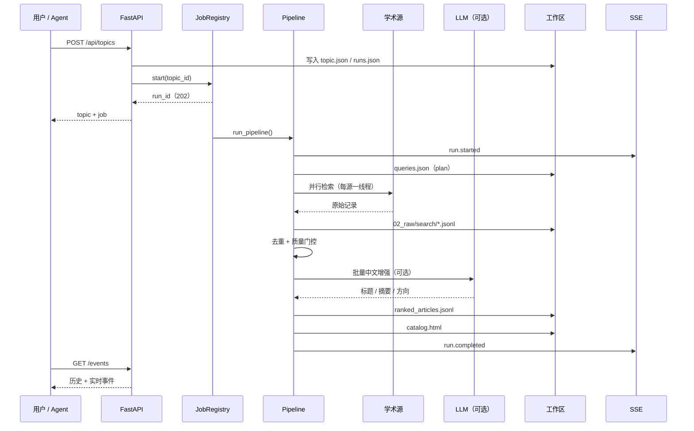
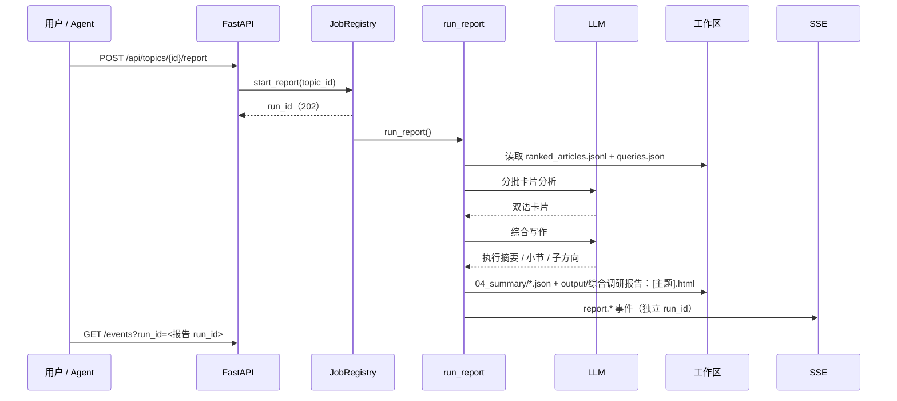

# Agent 执行流程

本文说明一次运行从输入到产物的完整链路：任务如何拆解、每一步调用什么工具、上下文与状态放在哪里、失败后如何恢复。

配图：[Agent 执行流程](diagrams/02-agent-flow.svg)（[PNG](diagrams/png/02-agent-flow.png)）。

## 1. 总览

调研报告是**独立任务**，不在上面这条链路里：目录生成后，用户或 Agent 单独触发它，避免控制台为一次可选、昂贵的调用等待一两分钟。

## 2. 阶段契约

每个阶段都有明确的输入、输出和失败语义。阶段之间只通过工作区文件或内存中的记录列表传递数据。检索链路有六个阶段；调研报告是链路之外的独立任务，契约单独放在 2.7。

### 2.1 plan — 查询规划

| | |
|---|---|
| 输入 | `topic.json`：主题名、关键词、问题、时间窗 |
| 决策 | 哪些来源与主题相关；每个来源用什么检索式 |
| 工具 | 可选 `llm.plan_queries` |
| 输出 | `01_queries/queries.json` |

来源选择规则（`sources_registry.py`）：

- 始终启用：OpenAlex（全学科）、arXiv（预印本）。
- 默认追加：Crossref（DOI 元数据）、DOAJ（开放获取）。
- 命中生物医学词表时追加：PubMed、Europe PMC。
- 配置了 `SEMANTIC_SCHOLAR_API_KEY` 时追加 Semantic Scholar。
- 单次运行最多 5 个来源，每源最多 2 条检索式。

检索式生成：

- 普通来源：`keyword1 AND keyword2`。
- arXiv：`all:"keyword1" AND all:"keyword2"`。
- 模型可额外提供同义词和更精确的布尔式，但必须落在已选来源内，且受每源 2 条的上限约束。

### 2.2 retrieve — 多源检索

| | |
|---|---|
| 输入 | `queries.json` |
| 工具 | `engine.sources.*_search` |
| 输出 | `02_raw/search/<source>.jsonl`、`manifests/retrieval.json` |
| 失败语义 | 单条查询失败记 `warning`；单源全失败记 `warning`；所有源都无结果才终止 |

并发模型：**每源一个线程，源内查询串行**。原因：`RateLimit` 是进程级的，串行才能保证 arXiv 的 3 秒间隔不被并发破坏。

### 2.3 normalize — 去重与门控

| | |
|---|---|
| 输入 | 全部原始记录 |
| 处理 | DOI 优先、标题指纹兜底去重；同组保留摘要最完整的记录；合并来源、查询、引用数 |
| 输出 | 可用记录（内存）、`03_processed/pending_verification_articles.jsonl` |
| 失败语义 | 没有可用记录时抛 `PipelineError`，提示放宽时间窗或更换关键词 |

质量门控复用 `content_quality.assess_abstract_quality`：摘要缺失、过短、模板页、标题重复、增补材料都会被拒，并写入 `pending_verification_reason`。

### 2.4 enrich — 中文增强（可选）

| | |
|---|---|
| 输入 | 前 `SEXTANT_LLM_MAX_CANDIDATES`（默认 40）条可用记录 |
| 工具 | OpenAI 兼容 `/chat/completions` |
| 输出 | `title_zh`、`abstract_zh`、`plain_summary_zh`、`research_direction` |
| 失败语义 | 超时、非 JSON、字段缺失 → 返回空 dict，链路继续 |

Prompt 明确禁止编造原文没有的结论；返回的 `record_id` 必须命中输入集合，否则丢弃。

### 2.5 rank — 相关性排序

| 分数项 | 上限 | 计算 |
|---|---:|---|
| 关键词覆盖 | 40 | 命中去重关键词数 / 关键词总数 × 40 |
| 标题命中 | 10 | 任一关键词出现在标题 |
| 引用影响力 | 20 | `min(20, log10(1+citations) × 6.5)` |
| 时效性 | 20 | ≤1 年 20；≤2 年 12；≤5 年 6；更早 1 |
| 跨源印证 | 5 | 两个及以上来源返回同一条 |
| 摘要质量 | 5 | 通过质量门控 |

结果按总分降序写入 `03_processed/ranked_articles.jsonl`，每条带 `rank`、`ranking_score`、`ranking_reasons`、`research_direction`。

方向归类：模型给出则采用；否则取「标题权重 2、摘要权重 1」计数最高的主题关键词；都没有则归入「其他相关研究」。

### 2.6 render — 目录生成

| | |
|---|---|
| 输入 | `ranked_articles.jsonl` + `topic.json` |
| 输出 | `output/catalog.html` |
| 失败语义 | 严格中文校验失败时自动降级重渲染，并记 `warning` |

产物是自包含 HTML：无外部 JS/CSS 依赖，按研究方向分组，支持搜索、来源/年份/类型筛选和中英对照。

### 2.7 report — 中英双语调研报告（独立任务，需 LLM）

报告不进入检索 pipeline：它昂贵（多次模型调用）且可选，因此由用户或 Agent 单独触发，拥有自己的 `run_id`、日志和 SSE 流。检索运行结束即释放控制台，目录先可用。

| | |
|---|---|
| 触发 | `POST /api/topics/{id}/report` 或 MCP `generate_report`；同一主题同一时刻只允许一个任务（检索或报告） |
| 输入 | 工作区已有的 `ranked_articles.jsonl` 前 N 篇（`SEXTANT_REPORT_MAX_PAPERS`，默认 20）+ `queries.json` 中的方向 |
| 中间产物 | `04_summary/paper_cards.json`、`report_content_zh.json`、`report_content_en.json` |
| 输出 | `output/综合调研报告：<主题>.html` |
| 失败语义 | 未配置模型、目录不存在、文献不足 3 篇或综合写作失败时任务以 `failed` 结束并给出原因；**不影响已生成的目录**，旧报告保持可打开 |

报告任务不写入 `runs.json`：那份文件驱动控制台的「最近一次运行」，报告不能伪装成一次新的检索。任务状态通过 job registry、`GET /api/runs/{run_id}` 和独立的 JSONL 日志查看。

检索运行会删除上一次的报告：排序结果已被替换，旧报告描述的证据集不再存在，继续展示会误导用户。

报告分两次模型调用完成：

1. **逐篇分析**：每 5 篇一批，输出 `abstract_only` 卡片所需字段——摘要、研究与应用影响、方法分类，中英双语。
2. **综合写作**：一次调用产出执行摘要、六个分析维度（研究问题 / 方法 / 样本 / 结果 / 局限 / 应用影响）和 3–6 个按方法家族聚类的子主题。

结构修复规则：未知 `record_id` 被丢弃，过短或缺失的小节用不涉及流程的降级文案补齐。**未被模型认领的论文按分析阶段已有的方法类别自动归组**（与现有子方向同名则并入），这一步不额外调用模型。为防止兜底制造噪音，规则有三条：只有一篇论文的类别不单独成组（那是逐篇研究方向，不是方法家族）；兜底组与模型组合计不超过 6 个，按组内论文数保留最大的几个；其余论文才进入「其他相关研究」。这样正常降级路径下 20 篇会落进 3–5 个真实方法家族，而不是十几个单篇小节或一个巨大的「其他」。若模型写出「本报告依据 N 篇论文摘要」「本次检索」这类**流程元信息**，带纠正指令重试一次；仍失败则记入 `report_notes`，不做静默放行。渲染器对双语完整性做严格校验，缺字段时拒绝渲染，报告任务以 `failed` 结束。

综合写作被截断时**提升 `max_tokens` 重试（16000 → 32000 → 64000），论文集保持不变**：截断源于推理 token 而非论文数量，减半论文实测无效且会把被砍掉的论文挤出综合。达到上限仍截断时返回空综合，报告层改用上述确定性方法家族分组，执行摘要与小节使用降级文案，**全部文献仍保留在报告中**，`report_notes` 记录截断与降级原因。只有网络错误、JSON 结构不合法这类「模型没给出任何可用内容」的情况，才不生成报告。

## 3. 上下文与状态管理

系统的「上下文」不是一段不断增长的对话，而是**分层的文件状态**：

| 层 | 位置 | 生命周期 | 谁写 | 谁读 |
|---|---|---|---|---|
| 主题定义 | `00_intake/topic.json` | 跨运行 | API / MCP | 所有阶段 |
| 本次计划 | `01_queries/queries.json` | 单次运行 | plan | retrieve、审计 |
| 原始证据 | `02_raw/search/*.jsonl` | 单次运行 | retrieve | normalize、审计 |
| 归一结果 | `03_processed/*.jsonl` | 跨运行 | normalize、rank | render、report、API |
| 报告中间产物 | `04_summary/*.json` | 跨运行 | report | render、审计 |
| 交付物 | `output/catalog.html`、`output/综合调研报告：*.html` | 跨运行 | render、report | 用户 |
| 事件流 | `logs/<run_id>.jsonl` | 跨运行 | runner、run_report | SSE、审计 |
| 运行历史 | `runs.json` | 跨运行 | runner / jobs | API、控制台 |

这样设计的原因：

- **可重入**：每个阶段只依赖文件，失败后可以从任意阶段重跑。
- **可对比**：两次运行的计划、原始返回、排序结果都在，能解释「为什么这次结果变了」。
- **可审计**：答辩时可以逐层下钻，而不是只看最终 HTML。

## 4. 异常与恢复路径

| 场景 | 系统行为 | 用户看到 |
|---|---|---|
| 单个来源超时 | 该源记 `warning`，其他源继续 | 时间线出现黄色「已降级」 |
| 全部来源无结果 | `PipelineError`，保留 `queries.json` | 红色错误 + 建议放宽时间窗/换关键词 |
| 摘要质量不足 | 进入待核实区，不参与排序 | 目录底部「待核实」分组 |
| 模型超时 | 降级为规则模式 | 「中文增强」阶段显示「跳过/已降级」 |
| 模型返回非法 JSON | 丢弃增强结果，继续 | 同上 |
| 中文校验不通过 | 降级渲染并告警 | 目录仍可用，日志有 `chinese_gate` |
| 报告写作出现流程元信息 | 带纠正指令重试一次，仍失败则记录原因 | 报告仍可打开，`report_notes` 说明降级点 |
| 综合写作被截断 | 预算翻倍重试（上限 64000），论文集不变；到顶仍失败则按方法家族确定性归组 | 报告仍含全部文献，`report_notes` 记录截断与降级 |
| 报告字段不完整 | 自动补降级文案；渲染器仍拒绝时任务失败 | 目录不受影响，报告卡片显示失败原因 |
| 报告任务失败 | 旧报告保留，任务状态 `failed` | 报告卡片显示原因与「重新生成」 |
| 检索与报告同时触发 | `JobConflict`，拒绝后启动的任务 | 409 + 当前占用任务 id |
| 进程重启 | 内存任务丢失，磁盘结果保留 | 主题列表仍能打开已有目录；未完成运行被标记为中断 |

人工介入点：失败后用户可以选择「重跑」、修改关键词新建主题，或直接查看 `logs/<run_id>.jsonl` 定位阶段。

## 5. 与 MCP Agent 的协作

MCP 暴露的是同一套 pipeline，而不是另一套实现：

- `create_topic` 适合需要异步推进的 Agent：拿到 `run_id` 后轮询 `get_run_status`。
- `run_topic` 适合一次性任务：阻塞直到目录生成，直接拿到路径与统计，并用 `report_hint` 提示下一步；它**不生成报告**，所以调用方不必为可选步骤等待。
- `generate_report` 在目录就绪后异步启动报告任务，返回 `run_id` 与 `status_url`，进度通过 `get_run_status` 查询。报告失败不会影响已有目录。
- `search_papers` / `score_records` 适合自定义循环：Agent 自己决定检索式和排序策略，只复用归一化与评分函数。

这样拆分的理由是成本与失败边界：检索是廉价、必经、可重跑的；报告是昂贵、可选、依赖模型的。把两者放进同一次调用，会让 Agent 的超时预算和用户控制台的等待时间都由最慢的可选步骤决定。

工具描述里写明了推荐链路，减少 Agent 的试错成本。
