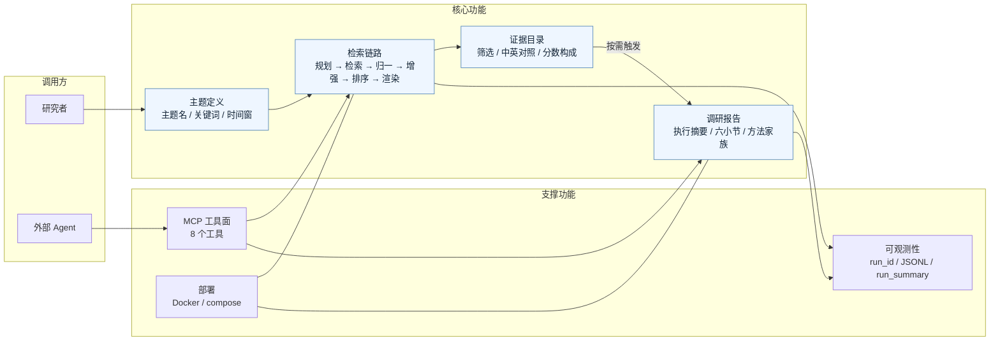
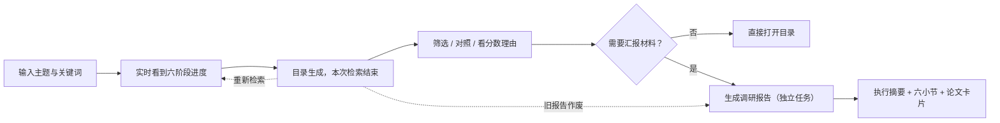
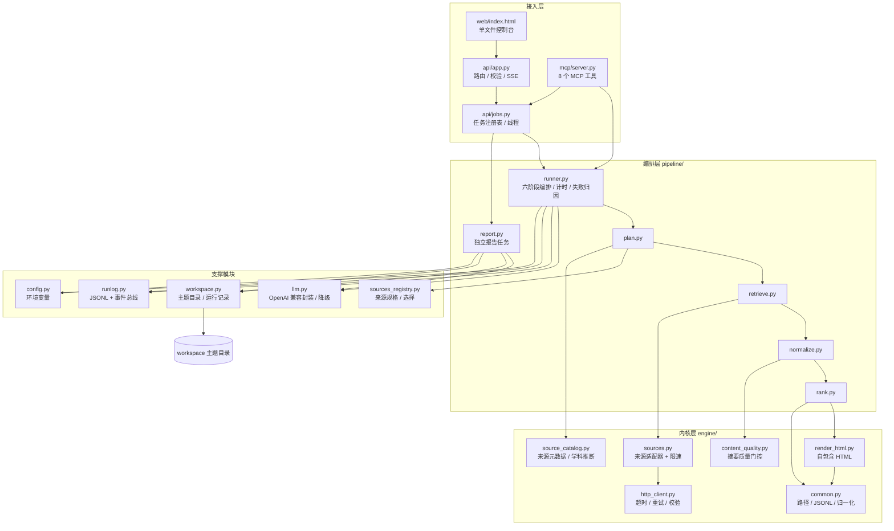
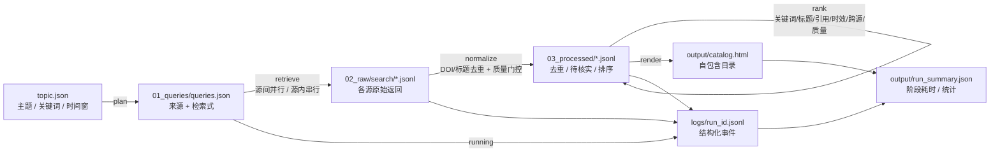
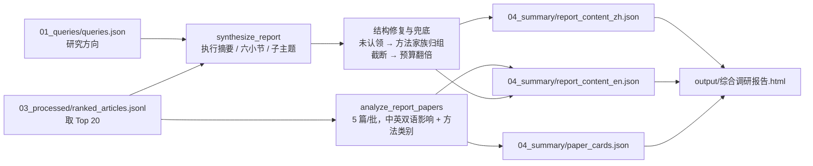
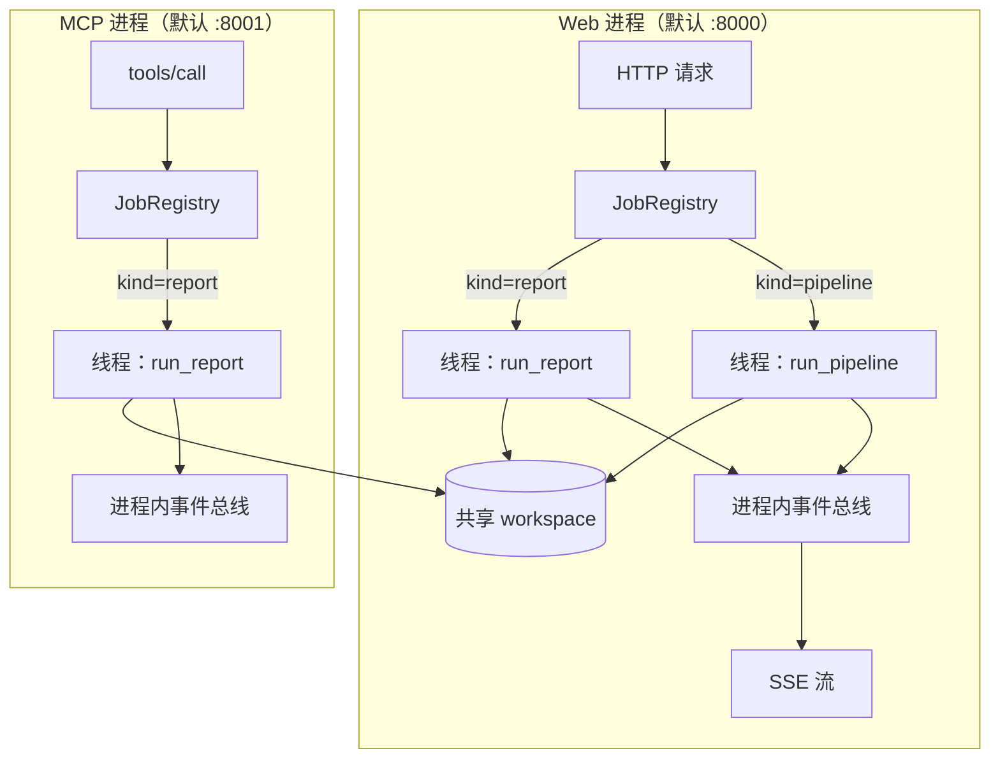
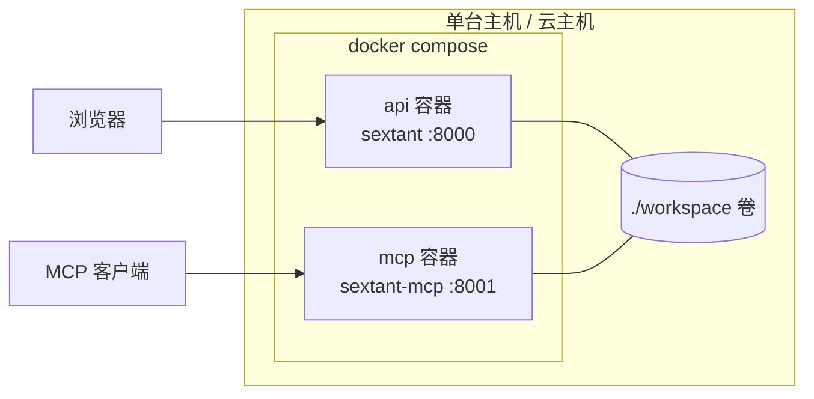

# 答辩指南：关键问答与架构

> 用途：现场 3 分钟 Demo + 7 分钟提问的速查材料。
> 前半部分是评委最可能追问的问题和可撑住 30 秒的答法；后半部分用两张架构图解释「功能怎么组织」和「代码怎么分块」。
> 详细证据见 [evidence.md](evidence.md)、[agent-flow.md](agent-flow.md)、[cost-and-performance.md](cost-and-performance.md)。
> 可放进 PPT 的图表与评分项映射见 [diagrams/README.md](diagrams/README.md)。

---

## 1. 30 秒定位（先背下来）

Sextant 是一个**研究情报追踪 Agent**：给定研究主题，从多个学术源并行检索、去重、按可解释规则排序，产出一个可筛选、可追溯的证据目录；目录就绪后，可按需生成中英双语调研报告。

三个设计决定：

1. **证据由确定性检索产生，模型只做增强**——不配置模型时整条链路照样可用。
2. **每个阶段落盘、可重入**——失败不会留下半截状态，下周能回答「当时为什么选这几篇」。
3. **报告与检索解耦**——报告是独立任务，有自己的 `run_id`、日志和 SSE，不阻塞主链路。

---

## 2. 最关键的问题

### 2.1 定位与价值

**Q1. 这和一个聚合搜索有什么区别？**

搜索解决「找到」，我们解决「找到之后到可汇报之间」。三个增量：跨源 DOI/标题去重；每条记录带可解释的分数构成；每次运行有 `run_id`、阶段日志和可重跑的工作区。

追问：分数构成是什么？——关键词覆盖 40 + 标题命中 10 + 引用 20 + 时效 20 + 跨源印证 5 + 质量 5，逐项写入记录。

**Q2. 核心创新是什么？**

不是模型能力，是把研究情报流程做成**有状态、可解释、可降级**的链路。具体是三个决定：确定性检索、阶段落盘可重入、报告与检索解耦。

**Q3. Agent 体现在哪里？**

三处：查询规划（模型扩展检索式，失败回退启发式）、报告写作（逐篇分析 + 综合）、MCP 工具面（外部 Agent 编排 `run_topic` / `generate_report`）。链路本身是确定性流水线，这是刻意选择，为了可复现。

**Q4. 为什么不作成一个聊天框？**

聊天框把不确定性放在入口，同一主题两次结果不可比。我们的入口是结构化主题定义，输出是结构化证据；模型失败时链路仍然可用。

**Q5. 用户为什么不直接用 Google Scholar？**

Scholar 不提供跨源去重、可解释排序、可复现工作区和机器可读接口，也不能接进 Agent。我们用公开 API，结果可追溯。

**Q6. 只做摘要级，价值够吗？**

够解决「初筛」这一段，也就是用户最耗时的 70–100 分钟。全文精读不在范围内，报告明确标注 `abstract_only` 和 `reading_basis`，不假装读过全文。

**Q7. 怎么证明排序有效？**

目前只有**可解释性**，没有人工标注的排序质量评估。分数逐项可见，用户可以判断「为什么这篇在前」；要证明优于 baseline，需要标注集，当前没做。

**Q8. 数据源合法吗？**

全部使用公开 API（OpenAlex、arXiv、Crossref、DOAJ、PubMed/Europe PMC、Semantic Scholar），遵守各自限速，只存元数据和摘要，不抓全文、不绕过付费墙。

**Q9. 中文文献、专利、行业报告呢？**

当前不覆盖，来源以英文学术元数据为主。这是能力边界，不是说「已经支持」。

### 2.2 架构与设计取舍

**Q10. 为什么是流水线，而不是让模型自己决定下一步？**

可复现、可测试、可计费。自治 Agent 的路径依赖模型判断，同一主题两次结果不同，无法解释「为什么这次少了 20 篇」。模型被限制在三个明确位置，每处都有确定性降级。

**Q11. 为什么用文件而不是数据库？**

单用户、单机、可审计优先。文件产物可直接打开、diff、手工修复，也没有 schema 迁移。代价是没有事务和并发写保护；多用户必须换 PostgreSQL + 任务队列。

**Q12. 阶段可重入怎么保证？**

每个阶段先读工作区、再整体覆盖写自己的产物；失败时保留上游产物。进程启动时 `reconcile_stale_runs` 把上次遗留的 `running` 标记为 `interrupted`，避免界面永久转圈。

**Q13. 写文件是原子的吗？**

**不是。** `write_json` 直接 `write_text`，进程在写入中途崩溃可能留下半截 JSON。当前靠「整体覆盖 + 单进程运行」规避；正确做法是临时文件 + `os.replace`。这是已知工程债。

**Q14. 为什么用线程而不是 asyncio？**

检索是阻塞的 urllib，每源一个线程让「源内串行、源间并行」的限速逻辑最简单；FastAPI 同步路由本身跑在线程池里。缺点是无法跨进程调度。

**Q15. 为什么不用 LangChain / LangGraph？**

链路是固定 DAG，不需要框架抽象；引入框架会增加依赖、隐藏失败路径，也让「无模型也能跑」变难。模型调用只有三个函数，自己封装约 700 行。

**Q16. 这套设计最大的技术风险是什么？**

进程内任务调度。服务重启会杀掉运行中的任务（会标记中断、产物保留）；多副本部署会同时写同一工作区。单机演示没问题，上云必须换持久队列 + 分布式锁。

### 2.3 检索、去重、排序

**Q17. 为什么选这几个源？**

OpenAlex 覆盖全学科且有引用数据，Crossref 补 DOI 元数据，arXiv 补预印本，DOAJ 补开放获取；生物医学主题自动追加 PubMed/Europe PMC。每源最多 2 条检索式、一次最多 5 个源。

**Q18. 来源是谁决定的？模型能加源吗？**

`active_sources` 先取核心源，再按主题词表判断学科；配置了 `SEMANTIC_SCHOLAR_API_KEY` 才加 S2。模型只能调整检索式，不能增加来源。

追问：ClinicalTrials/bioRxiv/medRxiv 有适配器，但当前运行路径未启用，作为能力储备。

**Q19. 某个源挂了怎么办？**

单条查询失败记 `warning`，单源全失败记 `warning`，其余源继续；所有源都无结果才抛 `PipelineError`。日志里能看到具体来源和错误类型。

追问：本地 PubMed 证书失败 4.8 秒超时，正好演示失败隔离。

**Q20. 去重算法具体是什么？**

先规范化 DOI（去 `https://doi.org/` 前缀、`/pdf` `/full` 等后缀、转小写），有 DOI 用 `doi:<值>` 做键；没有 DOI 才退回标题：去标点、压缩空白、转小写。同组保留摘要最完整的一条，并合并来源、查询、引用数。

追问：标题去重会误杀同名不同文，缓解方式是保留摘要最长者并保留全部来源。

**Q21. 质量门控的阈值凭什么定？**

默认摘要至少 45 词；临床试验 55 词；新闻/公告 30 词。模板页、补充材料标题、摘要复述标题都会被拒，进入待核实区。阈值是启发式，没有标注集校准。

**Q22. 排序权重为什么是 40/10/20/20/5/5？**

关键词覆盖决定相关性，给最高权重；引用和时效各 20 平衡重要性与新鲜度；跨源印证 5 作为可信度加成；质量 5 防止低质量摘要靠关键词堆分。权重是设计假设，不是拟合结果。

**Q23. 为什么不做向量召回？**

当前是关键词 + 元数据启发式，对同义表达不敏感（"LLM" 与 "large language model" 依赖模型扩展关键词）。下一步是 embedding 召回 + 保留可解释打分，不能直接用黑箱相似度替换。

### 2.4 LLM 与报告（评委最爱追问）

**Q24. 模型用在哪？失败会怎样？**

三处：plan 扩展检索式（失败回退启发式）、enrich 中文增强（失败保留原文）、report 分析与综合（失败不生成报告）。不配置模型时整条检索链路照常可用，这是硬约束。

**Q25. 报告为什么不放在检索链路里？**

报告要 4 次分析 + 1 次综合，约 80–200 秒。放进检索会让主链路等待一个可选步骤。独立任务有自己的 `run_id`、日志、SSE 和进程内互斥。

**Q26. 怎么防止模型编造？**

prompt 禁止摘要之外的结论；卡片只基于提供的摘要；不确定时要求定性表述；报告标注 `evidence_mode=abstract_only`。但**不能完全消除幻觉**，所以定位是辅助阅读，不是替代原文。

**Q27. 「本报告依据 20 篇论文摘要」这类句子怎么处理？**

三层：prompt 禁止、写入前检测（高精度词组）、命中后带纠正指令重试一次；仍失败记入 `report_notes`，不静默放行。

追问：词表为什么不含「去重」「时间窗口」？——它们是研究内容本身（记录去重、时序分析），误报会白烧一次综合调用。

**Q28. 综合写作被截断怎么办？**

先提升 `max_tokens` 重试 16000 → 32000 → 64000，论文集不变。实测证明截断来自推理 token，不是论文数（5 篇的思考量比 20 篇还高），减半论文无效。到顶仍截断则返回空综合，用方法家族确定性归组，全部卡片保留。

追问：为什么不直接把预算设到 64000？——成本和延迟；16000 覆盖绝大多数主题，只有推理量异常才升级。

**Q29. 模型没把论文分进任何子主题怎么办？**

按分析阶段已有的 `method_category` 归组，同名并入现有子主题；单篇类别不建组；兜底组与模型组合计不超过 6 个；只有没有方法类别的才进「其他」。用真实 20 篇数据验证：分析正常时 4 个家族、「其他」为空。

**Q30. 报告质量怎么评估？**

没有自动指标，也没有人工评分。当前验证的是结构完整性（字段、归属、双语、无元信息）和真实运行产物（20 篇、225 KB、`notes` 为空）。质量评估是下一步。

### 2.5 可靠性、并发、部署

**Q31. 两个任务同时跑会怎样？**

同一进程内，`JobRegistry` 按主题和类型互斥，冲突返回 409。**不同进程之间没有互斥**（Web 和 MCP 各一个进程），这是已知缺口；单机演示概率低，生产需要文件锁或分布式锁。

**Q32. 为什么报告不写 `runs.json`？**

`runs.json` 驱动「最近一次检索」，报告不是检索；写进去会污染运行历史和重跑语义。报告状态通过 job registry、独立日志和 `/api/runs/{id}` 查看。

**Q33. 重新检索后旧报告为什么删掉？**

旧报告描述的是上一批证据，排序结果已经变了，继续展示会误导。删除动作在检索成功后执行；报告任务失败则不删旧报告。

**Q34. 服务重启后正在跑的任务怎么办？**

标记为 `interrupted` 并写明原因，已完成的阶段产物保留，用户可重跑。不会假装还在运行。

**Q35. 怎么部署？需要哪些依赖？**

一条 `docker compose up --build` 启动：`api` 与 `mcp` 两个进程使用同一镜像、不同启动命令，共享 `./workspace` 卷；配置全走环境变量，带 `/api/health` 健康检查，容器以非 root 运行。不依赖外部数据库、消息队列或 GPU。

**Q36. 为什么用 SSE 而不是 WebSocket？**

单向推送足够；SSE 走普通 HTTP，反向代理配置简单；断线后浏览器自动重连，服务端先按 `seq` 回放再续推实时事件。当前没有客户端向服务端发消息的需求。

### 2.6 测试、安全与边界

**Q37. 测了多少？测的是真实网络吗？**

74 个测试，覆盖 pipeline、API、workspace、LLM 降级和报告结构，`ruff` 全绿。测试用 fixture 和 monkeypatch，不访问真实网络；真实网络只在手工实测中验证，日志在 `docs/evidence.md`。

**Q38. 有没有 CI / 端到端测试？**

**没有 CI**，靠本地 `pytest` + `ruff`；API 层有 TestClient 的端到端，但没有「真实四源 + 真实模型」的自动化 E2E。这是明确缺口。

**Q39. 密钥怎么管的？**

只从环境变量读取，`.env` 在 `.gitignore`，仓库里只有 `.env.example`；日志和错误信息不打印 key。

**Q40. 有没有注入 / SSRF 风险？**

用户输入只用于主题名、关键词、日期，进入检索式前做规范化；不拼 SQL（无数据库）、不执行用户代码；报告 HTML 由渲染器转义。外部请求的 URL 由来源适配器构造，用户不能指定任意 URL。**但没有做系统性安全审查**。

**Q41. 摘要发给模型，数据出境怎么办？**

启用模型时摘要会发送给模型供应商（当前是 DeepSeek 兼容接口）。公开摘要风险低，但需在部署文档声明；可配置 `SEXTANT_REPORT_ENABLED=0` 完全禁用。

### 2.7 五个陷阱题

**T1. 「这不就是调几个 API 加个 LLM 总结吗？」**

是，也不止。调 API 谁都会；难的是去重后仍保留跨源证据、排序可解释、每阶段可重入、模型失败可降级、报告与检索解耦。这些是工程约束，不是 API 调用。

**T2. 「模型完全不可用，你们还剩什么？」**

完整可用的检索、去重、排序、目录和日志；报告入口直接拒绝并说明原因。这是设计目标，不是事后兜底。

**T3. 「两个进程同时写报告会怎样？」**

会互相覆盖。当前只保证进程内互斥，这是已知缺口；演示时只从 Web 触发。

**T4. 「服务重启任务丢了，这算可靠吗？」**

不算高可靠，但失败是可见的：任务标记中断、产物保留、日志可查。我们用「可见的失败」换「简单可审计」。

**T5. 「给你一周，你改什么？」**

① 写文件改原子替换，避免异常退出留下半截文件；② 排序质量标注集和 baseline；③ CI + 真实网络 E2E；④ 全文/引用上下文；⑤ 向量召回。先修正确性和可验证性，再加能力。

### 2.8 不会答时的三段式

> 「当前版本没做 X。原因是 Y（成本 / 优先级 / 边界）。下一步会 Z。」

不要顺着评委的话承认没做过的功能；不要把「可解释」说成「已验证」。

### 2.9 不能说的话与数字速记

**不要说**：支持全文分析（只做摘要级）；排序经过验证（说可解释，未做标注评估）。

**数字**：74 tests · 6 阶段 · 5 源上限 · 2 查询/源 · 45 词阈值 · 40/10/20/20/5/5 权重 · 40 条增强 · 10 条/批 · Top 20 报告 · 5 篇/分析批 · 16k→32k→64k 预算 · 15s 心跳 · 8 个 MCP 工具 · 127.7s 全链路（含增强）· 80–135s 报告 · 非 root uid 10001。

---

## 3. 功能架构

### 3.1 功能全景

从用户视角看，系统由六个功能块组成；检索与报告是两条独立的主路径，共享工作区和可观测性。



### 3.2 功能块说明

| 功能块 | 解决什么 | 关键行为 | 失败时 |
|---|---|---|---|
| 主题定义 | 把研究问题变成可复现输入 | 主题名 + 关键词 + 时间窗；同名主题 409 防止覆盖 | 输入校验 400 |
| 检索链路 | 发现与初筛 | 6 阶段、源间并行、源内串行、逐阶段落盘 | 单源 warning；全空终止 |
| 证据目录 | 让人快速判断「读哪几篇」 | 按方向分组、来源/年份/类型筛选、中英摘要、分数构成 | 中文校验失败自动降级渲染 |
| 调研报告 | 把证据组织成可汇报叙事 | 独立任务、Top 20、双语、方法家族、失败不影响目录 | 任务 failed，旧报告保留 |
| 可观测性 | 让过程可解释、可追责 | 每阶段耗时、事件 seq、run_summary、日志回放 | 日志缺失时接口 404 |
| MCP 工具面 | 让 Agent 复用同一能力 | 8 个工具覆盖发现→启动→轮询→读取 | 结构化 `ok/error` |
| 部署 | 一条命令复现 | 同镜像双进程、共享 workspace 卷、健康检查 | compose 重启策略 |

### 3.3 用户旅程



---

## 4. 程序分块架构

### 4.1 分层与依赖方向

依赖方向固定为 `web → api → pipeline → engine`，`workspace` 只做文件 I/O。



### 4.2 目录结构

```
sextant/
├── sextant/
│   ├── __main__.py          CLI 入口：sextant --host --port
│   ├── config.py            环境变量集中读取，禁止业务代码直接 os.getenv
│   ├── workspace.py         主题目录、运行记录、路径约定、陈旧运行修复
│   ├── runlog.py            JSONL 事件 + 进程内事件总线
│   ├── llm.py               OpenAI 兼容调用：plan / enrich / analyze / synthesize
│   ├── sources_registry.py  来源规格、可用性、选择与查询构造
│   ├── engine/              纯函数内核，可独立测试
│   │   ├── sources.py       来源适配器（10 个来源 / 9 个函数）+ 限速
│   │   ├── http_client.py   urllib 封装：超时、重试、响应校验
│   │   ├── content_quality.py 摘要质量门控
│   │   ├── render_html.py   目录与报告渲染、严格校验
│   │   ├── common.py        路径、JSONL、日期、去重键、状态计算
│   │   ├── source_catalog.py 来源元数据与学科推断
│   │   └── abstract_labels.py 摘要来源标签
│   ├── pipeline/            垂直切片，每阶段一个文件
│   │   ├── runner.py        plan→retrieve→normalize→enrich→rank→render
│   │   ├── plan.py          查询规划
│   │   ├── retrieve.py      多源并发检索
│   │   ├── normalize.py     去重与门控
│   │   ├── rank.py          相关性打分
│   │   └── report.py        独立报告任务（run_report / build_report）
│   ├── api/
│   │   ├── app.py           路由、SSE、静态控制台
│   │   └── jobs.py          线程任务注册表（pipeline / report 两类）
│   ├── mcp/server.py        MCP server，复用同一 pipeline
│   └── web/index.html       单文件控制台（无构建步骤）
├── tests/                   74 个测试：api / pipeline / llm / report / workspace
├── docs/                    架构、流程、异常、可观测性、成本、答辩指南
├── scripts/demo.py          CLI 冒烟与演示脚本
├── Dockerfile               非 root、健康检查
└── docker-compose.yml       api(8000) + mcp(8001)，共享 workspace
```

### 4.3 模块职责与红线

| 层/模块 | 职责 | 不允许做什么 |
|---|---|---|
| `web/index.html` | 交互与展示 | 不直接发外部请求，不解析业务规则 |
| `api/app.py` | HTTP 边界：校验、状态码、SSE | 不解析外部响应体，不编排多阶段 |
| `api/jobs.py` | 线程调度、互斥、状态 | 不写业务文件，不调用来源 |
| `mcp/server.py` | 工具封装 | 不复制一套 pipeline 实现 |
| `pipeline/` | 阶段编排与业务规则 | 不直接发 HTTP（必须走 `engine.sources`） |
| `pipeline/report.py` | 报告结构与兜底 | 不改检索产物 |
| `engine/` | 纯函数：检索、解析、评分、渲染 | 不 import `api` / `pipeline`，不读全局状态 |
| `workspace.py` | 路径与状态的唯一入口 | 不让业务代码自己拼路径 |
| `llm.py` | 模型调用与降级 | 不决定业务语义；失败必须返回可降级结果 |
| `config.py` | 环境变量 | 业务代码直接 `os.getenv` |

### 4.4 检索链路数据流



每条记录在 `03_processed/ranked_articles.jsonl` 中保留：`record_id`、来源、标题、摘要、作者、日期、DOI、URL、引用数、`ranking_score`、`ranking_reasons`、`research_direction`。目录和报告都只依赖这份文件，保证二者看到的是同一批证据。

### 4.5 报告任务数据流



报告与检索的唯一耦合是工作区文件：报告只读 `ranked_articles.jsonl` 和 `queries.json`，不触发检索、不修改检索产物。因此检索结束多久之后都能生成报告，检索重跑会作废旧报告。

### 4.6 任务与并发模型



- 同一进程内：同一主题的 `pipeline` 与 `report` 互斥；冲突返回 409。
- 不同进程之间：**没有互斥**，这是已知缺口（见 Q31/T3）。
- 每个任务有自己的 `run_id`，日志按 `run_id` 隔离；检索写入 `runs.json`，报告不写。
- 目录生成后检索任务立即结束，报告任务单独启动，互不阻塞。

### 4.7 状态文件

| 文件 | 写入者 | 读取者 | 生命周期 | 说明 |
|---|---|---|---|---|
| `00_intake/topic.json` | API / MCP | 所有阶段 | 跨运行 | 主题定义 |
| `01_queries/queries.json` | plan | retrieve / report / 审计 | 单次运行 | 检索计划与方向 |
| `02_raw/search/*.jsonl` | retrieve | normalize / 审计 | 单次运行 | 原始证据 |
| `03_processed/*.jsonl` | normalize / rank | render / report / API | 跨运行 | 去重、待核实、排序 |
| `04_summary/*.json` | report | render / 审计 | 跨运行 | 报告中间产物 |
| `output/catalog.html` | render | 用户 | 跨运行 | 证据目录 |
| `output/综合调研报告：*.html` | report | 用户 | 跨运行 | 双语报告 |
| `output/run_summary.json` | runner | API / 审计 | 跨运行 | 运行汇总 |
| `logs/<run_id>.jsonl` | runner / run_report | SSE / 审计 | 跨运行 | 事件流 |
| `runs.json` | runner / jobs | API / 控制台 | 跨运行 | 检索运行历史 |

### 4.8 部署形态



两个容器使用同一镜像 `sextant:0.1.0`，只是入口命令不同；共享 `./workspace` 卷，所以 Web 生成的主题 MCP 能读，反之亦然。部署只需 `docker compose up --build`。

---

## 5. 现场追问索引

| 评委想看 | 打开 |
|---|---|
| 排序公式 | `sextant/pipeline/rank.py` |
| 去重 | `sextant/pipeline/normalize.py` 的 `dedupe_key` |
| 质量门控 | `sextant/engine/content_quality.py` 的 `assess_abstract_quality` |
| 来源选择与限速 | `sextant/sources_registry.py`、`sextant/engine/sources.py` 顶部 |
| 报告契约与兜底 | `sextant/pipeline/report.py`、`sextant/llm.py` 的 `synthesize_report` |
| 任务调度与互斥 | `sextant/api/jobs.py` |
| SSE 回放 | `sextant/runlog.py` 的 `iter_live_events` |
| 部署 | `Dockerfile`、`docker-compose.yml` |
